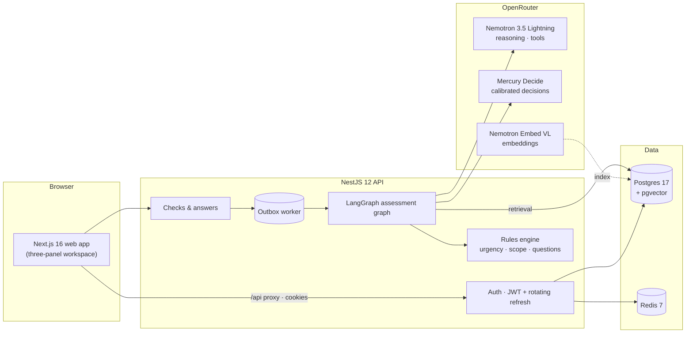
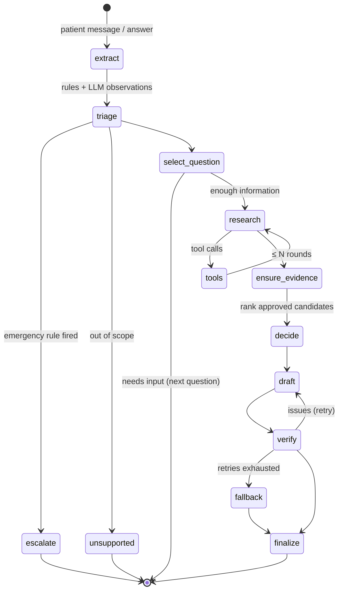

<p align="center">
  
</p>

<p align="center">
  
  
  
  
  
  
  
</p>

<p align="center">
  <b>Nora</b> is an enterprise, multi-tenant health assistant that helps adults understand common symptoms,<br>
  decide <i>how urgently</i> to seek care, and hand off to the right clinician — with every claim traceable to approved evidence.
</p>

> [!WARNING]
> **Not a medical device. Not for real patients.** All clinical content in this repository (rules, questions, explanations, knowledge sources, providers, medicines) is **synthetic demo data** that has not been clinically validated. It exists to exercise the software end to end.

---

## Why Nora is different

| Principle | How it is enforced |
| --- | --- |
| **Rules decide urgency, never the model** | A deterministic rules engine evaluates a versioned clinical bundle on every input. Emergencies short-circuit the pipeline before any LLM call. AI output can never lower urgency. |
| **Bounded explanations** | The model may only rank *approved candidate explanations* from the active bundle; it cannot invent diagnoses. |
| **Every claim is cited** | A read-only research agent retrieves approved passages; drafts are verified so each explanation cites retrieved evidence IDs. |
| **Verify, retry, fall back** | Drafts with uncited claims, diagnosis or dosing language are rejected and retried, then replaced by approved template content. |
| **Defence in depth** | A deterministic red-flag extractor always runs beside the LLM extractor; a critical finding it sees can never be dropped by the model. |
| **Tenant isolation & privacy** | Tenant-scoped data access, append-only consent, audit trails, idle timeouts, rotating refresh tokens and CSRF protection. |

## Architecture



### The assessment graph



Research tools are **read-only**: `search_knowledge`, `get_case_summary`, `get_source`. The orchestration is tested end to end with a scripted chat model that replays tool calls and structured outputs.

## Repository layout

```text
.
├── apps/
│   ├── api/                 NestJS API · Prisma 7 · LangGraph orchestration
│   │   ├── prisma/          schema, migrations, synthetic seed
│   │   └── src/
│   │       ├── auth/        JWT access + opaque rotating refresh, CSRF, roles
│   │       ├── clinical/    bundle schema, rules engine, synthetic content
│   │       ├── assessment/  extraction, graph, tools, verification
│   │       ├── ai/          OpenRouter model factory, scripted test model
│   │       └── knowledge/   retrieval port (full-text + vector)
│   └── web/                 Next.js 16 app (App Router, cacheComponents)
├── packages/
│   ├── brand/               design tokens, Tailwind theme, logo assets, guidelines
│   └── ui/                  shared accessible React components
├── infra/docker/            Postgres 17 + pgvector image
├── docs/assets/             README artwork
└── prd/                     product requirements
```

## Quick start

**Prerequisites:** Node 26, pnpm 12, and Docker or Podman (with Compose).

```bash
pnpm install
cp .env.example .env                       # add OPENROUTER_API_KEY to enable AI
cp apps/api/.env.example apps/api/.env     # then set JWT_ACCESS_SECRET (openssl rand -base64 48)

pnpm infra:up                              # Postgres (5433) + Redis (6379)
pnpm db:migrate && pnpm db:seed            # schema + synthetic India demo data
pnpm dev                                   # web http://localhost:3000 · api http://localhost:4000
```

Run the whole stack in containers instead with `pnpm stack:up`.

### Demo accounts

Every seeded account uses the password **`NoraDemo!2026`**.

| Email | Role | Notes |
| --- | --- | --- |
| `patient@demo.nora.local` | Patient | Profile and consent already on file |
| `priya@demo.nora.local` | Patient | Fresh account — exercises onboarding and consent |
| `clinician@demo.nora.local` | Clinician | Review queue |
| `coordinator@demo.nora.local` | Care coordinator | Handoffs and appointments |
| `admin@demo.nora.local` | Tenant admin | Capabilities, providers, settings |
| `editor@demo.nora.local` / `approver@demo.nora.local` | Content editor / approver | Four-eyes bundle workflow |
| `operator@nora.local` | Platform operator | Kill switches |
| `*@acme.nora.local` | Second tenant | Isolation testing |

## AI configuration

Nora talks to models through [OpenRouter](https://openrouter.ai). Without `OPENROUTER_API_KEY` it runs in **template mode**: rules, questions, care plans and evidence still work, and results are clearly labelled.

| Variable | Default | Role |
| --- | --- | --- |
| `OPENROUTER_MODEL` | `nvidia/nemotron-3.5-lightning:free` | Tool-calling research agent and drafting |
| `OPENROUTER_FAST_MODEL` | `nvidia/nemotron-3.5-lightning:free` | Structured symptom extraction |
| `OPENROUTER_DECISION_MODEL` | `inception/mercury-decide:free` | Calibrated ranking of approved candidates and an urgency cross-check (can escalate to review, never lowers urgency) |
| `OPENROUTER_EMBEDDING_MODEL` | `nvidia/llama-nemotron-embed-vl-1b-v2:free` | Knowledge embeddings (pgvector) |

## Testing

```bash
pnpm --filter @nora/api test          # rules engine, extraction, orchestration (scripted model)
pnpm --filter @nora/brand test        # token contrast + CSS/token sync
pnpm typecheck && pnpm lint
```

## Brand

<p>
  
  
  
  
</p>

Tokens, typography, layout and accessibility rules live in [`packages/brand`](packages/brand/GUIDELINES.md); the live reference page is `/brand` in the web app. Colour never carries meaning alone, every text pairing is contrast-tested, and urgency messaging is never obscured by tenant theming.

## Roadmap

**P0 — core safe assessment** (in progress)

- [x] Containerised infra, brand system, JWT auth with refresh rotation and CSRF
- [x] Data model for consent, profiles, checks, results, review, providers, audit and privacy
- [x] Versioned clinical bundle, deterministic rules engine and sentinel evaluation
- [x] Synthetic India seed: 2 tenants, 11 users, 6 concerns, knowledge library, 18 providers, 25 medicines
- [x] Rule-based red-flag extractor
- [ ] LangGraph assessment orchestration with read-only research tools
- [ ] Checks API, outbox worker and live stage events (SSE)
- [ ] Consent and profile, provider directory and handoff, medicines education
- [ ] Clinician review queue, tenant admin, audit, privacy requests, analytics, kill switches
- [ ] Workspace UI end to end

**P1** — voice input, report upload, live scheduling, notifications, clinician-signed guidance, more languages.
**P2** — personalised medicine guidance, EHR/FHIR integration, payments.

---

<p align="center">
  <br>
  <sub>Proprietary — all rights reserved. Synthetic demo content only; not for clinical use.</sub>
</p>
